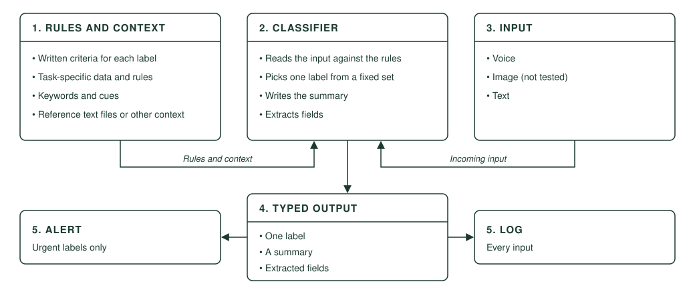

# I built Jev before Jev, Kinda

**A Jev-style typed-decision classifier, built in June 2026, three months before Jev's early access.**

Jev is TypeSafe AI's model for typed decisions. You give it some text and a question, and it returns an answer your code can use directly instead of prose. It entered early access on 15 September 2026.

In June 2026 I built the same pattern by hand for EterniCall, my startup. A classifier read each input against written rules and context, and returned a fixed-shape answer that code could act on without anyone reading it first.

Mine also did one thing Jev does not. It produced a summary.

## The pattern

1. **Rules and context.** Written criteria that say which label applies, plus the reference material they rely on.
2. **Classifier.** Reads the input against the rules and context.
3. **Input.** Voice or text.
4. **Typed output.** Always the same shape: one label from a fixed set, a summary, and extracted fields.
5. **Action.** Code reads the label and acts. Urgent labels send an alert to the person who needs to act. Every input is logged, whatever its label.

## The build story

I began building EterniCall in May 2026 and had the classifier working in June. It started with a narrow job, built for call centres.

The problem was this. A call centre agent takes the call and, at the same moment, has to judge how urgent it is and write it up. Doing all of that at once is slow, costly and easy to get wrong. EterniCall moved the judging and the write-up to after the call, where the classifier does both in one step.

A leading UK-based call centre tested it in two rounds of UAT. It classified more than 250 calls, and no wrong label or malformed output was reported.

Then I realised the pattern was not tied to that job at all. Everything specific to it sat in the rules and context. Change those, and the same classifier sorts any text into labels and sets off whatever should happen next.

EterniCall has now been sold to an angel investor.

## In this repository

- `technology/classifier.md` covers the pattern in full, how it maps to Jev, an example with different rules, and its limits.
- `case-study/call-centre.md` covers the call centre case study.
- `case-study/lessons-learned.md` covers what I would keep and what I would change.

This repository contains documentation only. It holds no source code and no prompt text.

Not affiliated with TypeSafe AI. Jev is their product, and the comparison here is mine.
