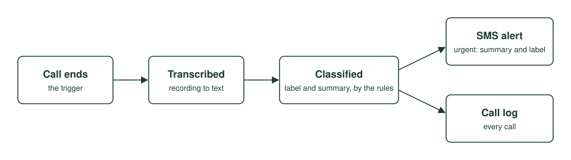

# Case study: call centre

EterniCall was an out-of-hours call handling startup built for call centres. This case study covers one stage of it: what happened after a call ended.

## The problem

A call centre agent takes the call and, at the same moment, has to judge how urgent it is and write it up. Doing all of that at once is slow, costly and easy to get wrong.

EterniCall moved that work to after the call. The agent handles the conversation. The classifier then decides the label and writes the summary, cheaply, within seconds, and in the same shape every time.

## The post-call stage

1. **A call ends.** The end of the call is the trigger. Nothing below needs a person to start it.
2. **It is transcribed.** The recording becomes text.
3. **It is classified.** The classifier reads the transcript against the rules and picks one of three labels: urgent class 1, urgent class 2 or non-urgent class 1.
4. **It is summarised.** In the same step, the classifier writes a short summary and extracts the caller's number and name.
5. **It is logged.** Every call goes into the call log with its label, summary and caller details.
6. **An alert goes out.** If the label is urgent, the person on call gets an SMS carrying the summary and the label.

Steps 3 and 4 are a single request. One typed output feeds both the log and the alert, so the two can never disagree about what the call was.

## Why three labels

Both urgent classes sent an alert, so the alert alone needed only two. The third label earned its place in the call log, where the two urgent classes were displayed differently and could be sorted apart. Whoever opened the log in the morning could see what kind of night it had been without reading every entry.

## Why after the call

Classifying after the call kept it away from the conversation itself. The live call had to be quick. The classifier did not, so it could read the whole transcript once and carefully.

## Testing

A leading UK-based call centre ran two rounds of UAT. Across development and both rounds, the classifier handled more than 250 calls.

No wrong label or malformed output was reported. The testers said it held up on the harder calls, where the caller's need was not stated plainly.
